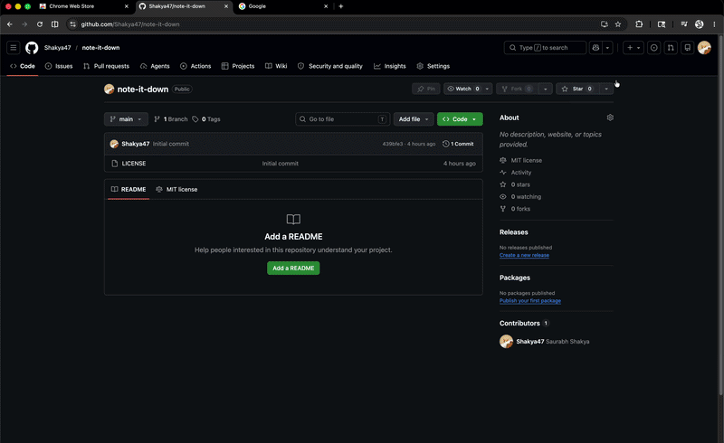

# Note It Down 📝



A note-taking Chrome extension with a floating **Picture-in-Picture** editor, plus a small phone app. Notes sync between your devices through your own Cloudflare Worker, end-to-end encrypted.

## Features

- **Floating editor**: pop any note into an always-on-top Picture-in-Picture window while you browse.
- **Offline first**: notes live on your device and work without internet.
- **Private sync (optional)**: notes are encrypted on your device before upload. Your worker stores a locked blob it cannot read.
- **Phone app**: the same notes on your phone, installable to the home screen, served by your own worker.
- **Light & dark themes**.

---

## Quick start

### 1. Install the extension (about 2 minutes)

You need [Node.js](https://nodejs.org) 22 or newer and [pnpm](https://pnpm.io/installation), plus Chrome 116 or newer.

1. Clone this repository.
2. `pnpm install`
3. `pnpm build`
4. Open `chrome://extensions`, turn on **Developer mode** (top right).
5. Click **Load unpacked** and select the `dist` folder.
6. Pin the extension and click its icon on any page to open the drawer.

After changing code, run `pnpm build` again and click ↻ on the extension in `chrome://extensions`.

### 2. Set up sync and the phone app (optional, about 10 minutes)

Your sync server runs on **your own** free Cloudflare account. Nobody else holds your data or your login.

1. Click the button and follow the prompts (a free Cloudflare account and a GitHub account are needed). Keep the default settings. When it finishes you get your worker URL.

   [](https://deploy.workers.cloudflare.com/?url=https://github.com/Shakya47/note-it-down)

   Prefer the terminal? `npx wrangler login`, then `pnpm run deploy`. Full guide: **[sync-worker/README.md](sync-worker/README.md)**.
2. Extension: drawer → **☁️ Sync** → **Set up sync** → paste the URL → **Generate** a token → **Save & Sync**.
3. Phone: open the worker URL → ⚙️ → paste the **same** token → **Save & Sync** → add it to your home screen.

Yes, the token is copied by hand on purpose. A QR code would be easier, but it would put your key on screen where anyone could capture it. [More on why](sync-worker/README.md#connect-your-phone).

---

## How it works

```
  LAPTOP                              CLOUDFLARE (your account)                PHONE
┌──────────────────────┐            ┌────────────────────────────┐        ┌──────────────────────┐
│ Chrome extension     │            │ Worker  (sync-worker/)      │        │ Phone app  (web/)    │
│ notes in Chrome      │ ── sync ─▶ │ /v1/...  → sync mailbox     │ ◀ sync │ notes in the phone   │
│ storage              │ ◀───────── │ /        → phone app files  │ ──────▶│ browser (IndexedDB)  │
└──────────────────────┘            └────────────────────────────┘        └──────────────────────┘
```

- **Extension** (`src/`): the drawer, editor and options page. Notes are stored in Chrome on your computer. A background service worker saves notes and runs sync.
- **Worker** (`sync-worker/worker.js`): a tiny program Cloudflare runs at your `*.workers.dev` URL. It is a mailbox: it keeps one encrypted blob per sync ID and only lets you replace it if you hold the token. The same URL also serves the phone app's files.
- **Phone app** (`web/`): a small web app that keeps notes on the phone and syncs through the same mailbox. Once loaded it works offline.
- **Sync token**: a random secret generated by the extension. It never leaves your devices; it is used to encrypt notes, find your mailbox and prove you may write to it. Every device with the same token sees the same notes. The **Sync ID** shown under the token is a fingerprint of it — it must match on all devices.

### What a sync does

1. Download the encrypted blob and decrypt it with the token.
2. Merge it with local notes. Each device remembers the version of every note at the last sync: if only one side changed a note, that change wins; if both did, the newer edit keeps the note and the other is saved as a `⚠️ [CONFLICT]` copy. Nothing is silently lost.
3. Encrypt the result and upload it, but only if something changed. The worker rejects the upload if another device wrote in the meantime; the device then re-downloads, re-merges and retries.

Sync runs automatically: when the browser or app opens, a few seconds after edits, every few minutes, and when you open the drawer. The drawer's **☁️ Sync** tab and the phone app's status pill show the current state.

---

## Using it

| Where | How |
| :--- | :--- |
| Open the drawer | Click the toolbar icon on any normal web page. |
| Edit a note | Click it in the drawer. It opens in a floating Picture-in-Picture window. On plain `http://` pages (where Picture-in-Picture isn't available) it opens inside the drawer instead. |
| Sync settings | Drawer → **☁️ Sync** → **Sync settings** (opens the extension's options page). |
| Phone app | Open your worker URL. iPhone: Safari → Share → **Add to Home Screen**. Android: Chrome → ⋮ → **Install app**. |

---

## Troubleshooting

| Symptom | Fix |
| :--- | :--- |
| Notes don't appear on another device | Compare the **Sync ID** in both places. If they differ, the devices use different tokens: copy the token from one device and paste it on the other. |
| "Sync failed" | Open sync settings to see the error. Check the Worker URL starts with `https://`. |
| Drawer says "Note It Down was updated or reloaded" | The extension was updated while the page was open. Copy any unsaved text, then reload the page. |
| Clicking the icon does nothing (red **!** badge) | Chrome doesn't allow extensions on that page (e.g. `chrome://`, the Web Store). Try a normal website. |
| A `⚠️ [CONFLICT]` note appeared | The same note was edited on two devices before they synced. Keep the version you want and delete the other. |
| `pnpm run deploy` says "Not logged in" | Run `npx wrangler login` and try again. |

---

## Development

| Command | What it does |
| :--- | :--- |
| `pnpm dev` | Watch-build the extension (load `dist` in Chrome). |
| `pnpm build` | Build the extension into `dist`. |
| `pnpm dev:web` | Run the phone app at http://localhost:5180. |
| `pnpm build:web` | Build the phone app into `sync-worker/public`. |
| `pnpm run deploy` | Build the phone app and deploy it together with the worker to your Cloudflare account (`wrangler.toml`). Note: `pnpm deploy` without `run` is a different, built-in pnpm command. |
| `pnpm test` | Run the tests (merge rules, sync end-to-end against the worker code, storage). |
| `pnpm lint` | Lint. |

### Project layout

```
src/
  background.ts, background/   extension service worker: note storage + sync scheduling
  content/                     the in-page drawer (closed shadow DOM)
  components/                  note list and editor (shared with the phone app)
  options/, ui/settings/       sync settings page and drawer sync status
  lib/                         note model, storage logic (shared), messaging
  sync/                        encryption, merge and sync engine (shared)
web/                           phone app (PWA)
sync-worker/                   Cloudflare Worker + deployment guide
```

The extension and the phone app share the same note model, storage rules, merge logic and encryption (`src/lib`, `src/sync`), so they always sync the same way.

---

## Privacy & security

- Notes and the token stay on your devices; the worker only ever sees encrypted data.
- Sync settings live on the extension's own options page; websites can't read the token or your notes from the drawer.
- The drawer is only injected into a page when you click the extension icon.

---

## Technical notes

| Challenge | Solution |
| :--- | :--- |
| Document Picture-in-Picture is blocked in extension popups and needs a direct user click. | The UI is injected into the page as a drawer, so a click on a note is a real page gesture that can open the PiP window. |
| Strict sites block lazy-loaded script chunks (CSP). | The content script is bundled as one standalone script. |
| The PiP window and the shadow root don't see the page's or extension's stylesheets. | The compiled CSS is inlined into the content script at build time and injected as `<style>` into both, with no web-accessible file for sites to probe. |
| Host pages' CSS and scripts interfere with injected UI. | The drawer lives in a closed shadow root attached to `<html>`, so page scripts can't reach in and `<body>` swaps don't remove it. |
| The server must authorise writes without seeing the token. | HKDF derives separate keys from the token; writes are checked with an HMAC of a derived verify key. |

Built with [`@pip-it-up/react`](https://www.npmjs.com/package/@pip-it-up/react) for the Picture-in-Picture window.

## License

MIT — see [LICENSE](LICENSE).
